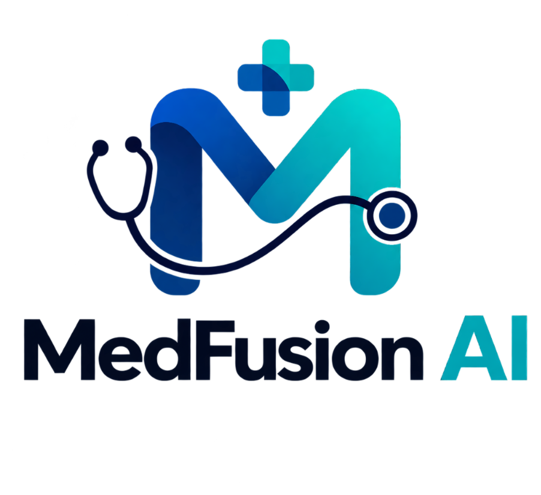
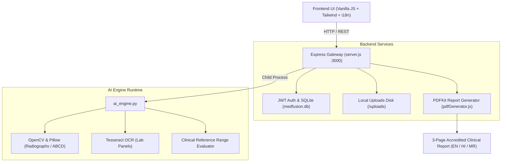

<div align="center">

# 🩺 MedFusion AI

### **Hospital-Grade Multimodal Medical Analysis & Clinical Report Platform**

[](https://nodejs.org/)
[](https://www.python.org/)
[](https://www.docker.com/)
[](https://render.com/)
[](LICENSE)
[](#-multilingual-clinical-reporting)

<p align="center">
  
</p>

MedFusion AI is a patient-facing and physician-supportive health intelligence system that correlates **medical imaging (X-rays, skin lesions)** and **laboratory documents (blood & metabolic panels)** into unified clinical summaries and accredited 3-page PDF medical reports.

</div>

---

## 📑 Table of Contents

- [Key Capabilities](#-key-capabilities)
- [System Architecture](#-system-architecture)
- [Supported Medical Modalities](#-supported-medical-modalities)
- [Multilingual Clinical Reporting](#-multilingual-clinical-reporting)
- [Project Directory Structure](#-project-directory-structure)
- [Quick Start / Local Setup](#-quick-start--local-setup)
- [Testing & Validation Suite](#-testing--validation-suite)
- [Production Deployment](#-production-deployment)
  - [Deploy on Render](#1-deploy-on-render-recommended)
  - [Deploy with Docker](#2-deploy-with-docker)
  - [Deploy on Railway](#3-deploy-on-railway)
- [Environment Variables](#-environment-variables)
- [Regulatory & Clinical Disclaimer](#-regulatory--clinical-disclaimer)

---

## 🌟 Key Capabilities

* **Multimodal Correlation**: Cross-references radiological observations with blood biomarkers (e.g. associating costophrenic effusions or pulmonary opacity with inflammatory WBC shifts).
* **Real Computer Vision & Dermoscopy**:
  - **Chest X-Ray**: Lung symmetry calculation, parenchymal opacity variance, Cardiothoracic Ratio (CTR), and costophrenic angle integrity.
  - **Skin Lesion ABCD Engine**: Asymmetry scoring, border irregularity index, color variegation detection across pigment ranges, and metric diameter estimation.
  - **Bone Radiographs**: Cortical continuity tracking and fracture screening.
* **Laboratory OCR & Reference Engine**:
  - Automated parameter extraction across CBC (Hematology), Diabetes/Metabolic, Lipid Panels, Renal Function (KFT), and Liver Function (LFT).
  - Flags abnormal biomarkers against clinical reference intervals with severity grading.
* **Hospital-Grade 3-Page PDF Reports**:
  - Guaranteed exact **3-page structure** with zero trailing or blank pages.
  - Full native typography in **English**, **Hindi (हिन्दी)**, and **Marathi (मराठी)**.
  - Official electronic verification seal with SHA-256 provenance checksum.
* **Single-Port Architecture**: Express.js server serving the responsive dark-mode frontend alongside authenticated REST APIs on port `3000`.

---

## 🏛 System Architecture



---

## 🔬 Supported Medical Modalities

### 1. Chest Radiography (PA View)
- Evaluates parenchymal lung fields for focal consolidations or opacities.
- Measures Cardiothoracic Ratio (CTR baseline `< 0.50`).
- Checks costophrenic angles for signs of fluid or blunting.

### 2. Dermoscopic Skin Lesions (ABCD Standard)
- **A (Asymmetry)**: Two-axis contour centroid variance.
- **B (Border Irregularity)**: Convex hull perimeter compactness ratio.
- **C (Color Variegation)**: Distribution across light brown, dark brown, red/erythema, and blue-gray hues.
- **D (Diameter)**: Metric scale estimation against clinical thresholds (> 6.0 mm).

### 3. Laboratory Panels (Blood & Metabolic Panels)
- **Hematology (CBC)**: Hemoglobin, WBC, RBC, Platelets, Hematocrit, Neutrophils, Lymphocytes.
- **Metabolic & Diabetes**: Fasting Blood Sugar (FBS), Postprandial (PPBS), HbA1c.
- **Lipid Panel**: Total Cholesterol, HDL, LDL, Triglycerides.
- **Renal Panel (KFT)**: Serum Creatinine, Blood Urea Nitrogen (BUN), eGFR.
- **Hepatic Panel (LFT)**: ALT (SGPT), AST (SGOT), Bilirubin, Albumin.

---

## 🌐 Multilingual Clinical Reporting

MedFusion AI generates hospital-standard reports localized in 3 languages using bundled Devanagari typography (`NotoSansDevanagari.ttf`):

| Page | Section | Contents |
| :---: | :--- | :--- |
| **Page 1** | **Executive Summary** | Institution Header, Patient Demographics, Study Metadata, Overall Status Banner, Verified Source Thumbnail, Preliminary AI Impression. |
| **Page 2** | **Detailed Clinical Findings** | Structured Biomarker/Anatomical Table, Reference Bounds, Technical Quality Assurance Metrics, Quantitative Measurements. |
| **Page 3** | **Interpretation & Action Plan** | Evidence Synthesis & Uncertainty Context, Step-by-Step Follow-Up Timeline, Red-Flag Emergency Indicators, Institutional Seal & Electronic Signature. |

---

## 📂 Project Directory Structure

```text
MedFusion-AI/
├── assets/                       # Brand logos, icons, fonts & sample captures
│   ├── fonts/                    # NotoSansDevanagari.ttf (Hindi/Marathi rendering)
│   ├── medfusion_logo.png        # Official transparent full brand logo
│   └── medfusion_icon.png        # Official brand emblem icon
├── medfusion-frontend/           # Production web application
│   ├── index.html                # Platform landing page & live interactive demo
│   ├── dashboard.html            # Patient portal dashboard
│   ├── new-analysis.html         # Modality & analysis selector
│   ├── upload.html               # Multi-zone drag-and-drop document upload
│   ├── processing.html           # Real-time fusion pipeline animator
│   ├── results.html              # Interactive findings display & PDF exporter
│   ├── navbar.html               # Shared global navigation sidebar
│   ├── js/                       # API clients, authentication & i18n logic
│   └── css/                      # Custom stylesheets
├── routes/                       # Express API routing
│   ├── api.js                    # REST API: auth, upload, AI execution, report fetch
│   ├── pdfGenerator.js           # 3-Page hospital PDF report generator
│   └── pdfTranslations.js        # English, Hindi & Marathi clinical dictionary
├── ai_engine.py                  # Real computer vision, ABCD & OCR engine
├── db.js                         # SQLite connection & schema initialization
├── server.js                     # Single-port Express entry point
├── validate_system.js            # Automated 24-point end-to-end verification suite
├── Dockerfile                    # Production dual-runtime container definition
├── docker-compose.yml            # Container orchestration with volume mounts
├── render.yaml                   # 1-Click Render blueprint deployment spec
├── requirements.txt              # Python computer vision & OCR dependencies
├── package.json                  # Node.js dependencies and lifecycle scripts
└── .env.example                  # Environment configuration template
```

---

## 🚀 Quick Start / Local Setup

### Prerequisites
- **Node.js**: v18.x or v20.x LTS
- **Python**: v3.10 or higher
- **Tesseract OCR** (optional, recommended for lab reports):
  - Windows: [Tesseract Installer](https://github.com/UB-Mannheim/tesseract/wiki) (default: `C:\Program Files\Tesseract-OCR\tesseract.exe`)
  - Linux: `sudo apt install -y tesseract-ocr`

### 1. Clone & Install Dependencies
```bash
# Clone the repository
git clone https://github.com/YOUR_USERNAME/MedFusion-AI.git
cd MedFusion-AI

# Install Node.js dependencies
npm install

# Install Python dependencies
pip install -r requirements.txt
```

### 2. Configure Environment
```bash
# Copy template to .env
cp .env.example .env
```
*(The defaults in `.env` are pre-configured to run out of the box).*

### 3. Start the Single-Port Server
```bash
npm start
```

Open **`http://localhost:3000`** in your browser.

- **Demo Account (1-Click Login)**:
  - Email: `test@medfusion.ai`
  - Password: `Password123`

---

## 🧪 Testing & Validation Suite

MedFusion AI includes a comprehensive 24-point automated validation script covering every endpoint, AI classifier, fallback route, and multilingual PDF generator:

```bash
node validate_system.js
```

**Expected output:**
```text
====================================================
🩺 MedFusion AI - Verification & Validation Suite
====================================================
✅ PASS: Server API /health is operational
✅ PASS: Chest X-ray upload & real analysis succeeded
✅ PASS: Computed real sharpness variance for chest X-ray
✅ PASS: Skin lesion upload & ABCD analysis succeeded
✅ PASS: Computed ABCD Asymmetry index
✅ PASS: Blood test OCR & rule evaluation succeeded
✅ PASS: Safeguard auto-corrected incompatible module
✅ PASS: Gracefully rejected corrupted file with HTTP 422
✅ PASS: Generated Chest X-ray Hospital PDF in English
✅ PASS: Generated Chest X-ray Hospital PDF in Hindi (Devanagari)
✅ PASS: Generated Chest X-ray Hospital PDF in Marathi (Devanagari)
...
====================================================
Results: 24 / 24 tests passed (100%)
🎉 ALL TESTS PASSED! System is fully functional.
```

---

## ☁️ Production Deployment

### 1. Deploy on Render (Recommended)

MedFusion AI includes a ready-to-use [`render.yaml`](render.yaml) blueprint:

1. Push this repository to GitHub.
2. Sign in to **[dashboard.render.com](https://dashboard.render.com)**.
3. Click **"New +"** &rarr; **"Web Service"** &rarr; Connect your GitHub repository.
4. Set **Runtime** to **`Docker`**.
5. Add the following **Environment Variables**:
   - `PORT`: `3000`
   - `NODE_ENV`: `production`
   - `JWT_SECRET`: *(A secure random 64-character string)*
6. Click **"Deploy Web Service"**.

---

### 2. Deploy with Docker

Run directly with Docker Compose on any VPS (AWS EC2, DigitalOcean, Hetzner):

```bash
# Build and start container in detached mode with persistent volume storage
docker compose up -d --build
```

To view live container logs:
```bash
docker compose logs -f medfusion-ai
```

---

### 3. Deploy on Railway

1. Log in to **[railway.app](https://railway.app)** and click **"New Project"** &rarr; **"Deploy from GitHub repo"**.
2. Railway will automatically detect the **Dockerfile**.
3. Under the service's **"Volumes"** tab, attach a persistent volume mounted to:
   ```text
   /app/uploads
   ```
4. Set `PORT=3000`, `NODE_ENV=production`, and `DB_PATH=/app/uploads/medfusion.db`.
5. Click **"Generate Domain"** under Settings &rarr; Networking.

---

## ⚙️ Environment Variables

| Variable | Default | Purpose |
| :--- | :--- | :--- |
| `PORT` | `3000` | Port on which the Express server listens. |
| `HOST` | `0.0.0.0` | Network binding interface. |
| `NODE_ENV` | `development` | Set to `production` in live environments. |
| `JWT_SECRET` | *(string)* | Secret key used to sign and verify JWT authentication tokens. |
| `DB_PATH` | `./medfusion.db` | Absolute or relative path to the SQLite database file. |
| `UPLOADS_DIR` | `./uploads` | Directory for ingested patient radiographs and laboratory scans. |
| `PYTHON_PATH` | `python` / `python3` | Command or path to the Python runtime executable. |
| `TESSERACT_CMD` | `auto-detected` | Path to the Tesseract binary (e.g. `/usr/bin/tesseract`). |

---

## ⚖️ Regulatory & Clinical Disclaimer

> **IMPORTANT MEDICAL NOTICE**:
> MedFusion AI is developed strictly as an **educational, informational, and supportive clinical intelligence platform**. It is **not** a certified medical diagnostic device and does **not** provide definitive diagnoses, prescriptions, or clinical treatment plans. 
> 
> All automated findings, preliminary impressions, biomarker ranges, and ABCD scores are algorithmic suggestions intended to assist clinical review. Clinical decision-making must always be performed by licensed physicians and healthcare professionals.
